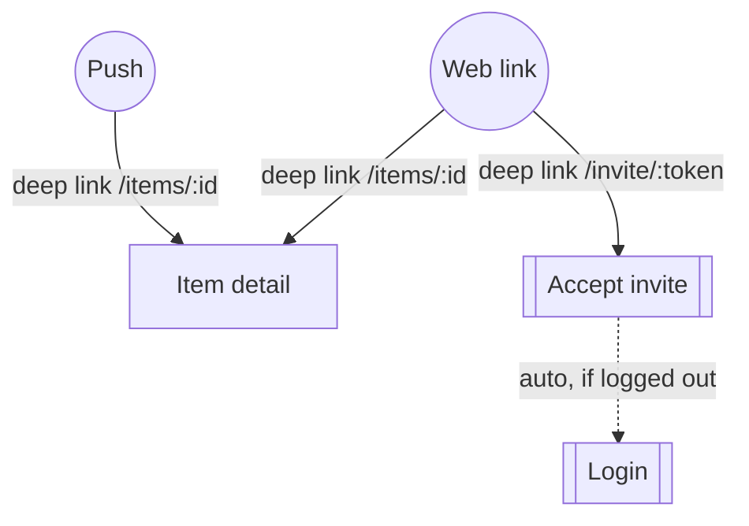

# Deep linking

Used at step 2. Every web URL a user can receive (email, message, push, search result) must land on the right screen in the app, or fall back to the web.

## Route mapping table

Write it in the contract under the navigation graph.

```md
| Web route | App screen (graph id) | Params | Auth | Back goes to | If unavailable |
|-----------|-----------------------|--------|------|--------------|----------------|
| /items/:id | detail | id | required | home | "Not found" state, link to list |
| /invite/:token | acceptInvite | token | none, then login | home | Web fallback |
| /settings/billing | — (dropped) | | | | Open in browser |
```

Every route that appears in an email, push or share must have a row. Dropped features map to the web on purpose.

## Universal Links and App Links

| | iOS: Universal Links | Android: App Links |
|---|---|---|
| File on the domain | `/.well-known/apple-app-site-association` (JSON, no extension) | `/.well-known/assetlinks.json` |
| Content | App ID (team ID + bundle ID), path or component patterns | Package name, SHA-256 certificate fingerprints |
| App side | Associated Domains entitlement `applinks:example.com` | Intent filter with `android:autoVerify="true"`, scheme `https`, host |
| Served | HTTPS, no redirect, valid certificate; fetched through Apple's CDN, so changes are not instant | HTTPS, no redirect, `application/json` |
| Common failure | Wrong team ID, redirect on the file, path pattern too narrow | Missing Play App Signing fingerprint (only the upload key listed) |
| Passkeys reuse | `webcredentials:` in the same entitlement | Same file with the `get_login_creds` relation |

Custom schemes (`myapp://`) are only a fallback for internal use: any app can claim them and they do not fall back to the web.

## Push payload routing

| Rule | Detail |
|------|--------|
| One field | The payload carries the same URL as the web (`"url": "https://example.com/items/42"`), routed through the same mapping table |
| Three app states | Foreground (in-app banner, no navigation forced), background, killed (cold start): test each |
| Stale target | The item may be gone by the time the push is opened: handle "not found" |
| Analytics | Tag the source (push, email, share) in the link, not in a separate code path |

## Edge cases

| Case | Behavior |
|------|----------|
| User not logged in | Store the destination, show login, then navigate to the destination; do not drop it on the home screen |
| Logged in as another account | Say which account the content belongs to; offer to switch |
| Content deleted | Destination screen shows its "not found" state with a way to the list |
| Content forbidden (role, plan) | Explain why, offer the path to get access or go back |
| App not installed | The URL opens the website, which can show a smart app banner; nothing else to build |
| App installed, version too old | Unknown route → open the web page, or forced update if the route is core |
| Route not handled in the app | Open the web page in the browser, on purpose (listed in the mapping table) |
| Deferred deep link (install, then open) | Needs a third-party service or install referrer; mark as an open decision |

## Back stack after a deep link

Judgment, aligned with the Android navigation principles: a deep link to a detail screen builds the stack the user would have had (tab root, then detail). Back from it goes to the tab root, never out of the app on Android without warning, never to an empty screen on iOS.

## Notation in the graph

Extends [navigation-graph.md](navigation-graph.md): one external entry node per source, edges labelled `deep link <route>`.



Dashed arrow for redirects the user does not choose (auth, not found).
