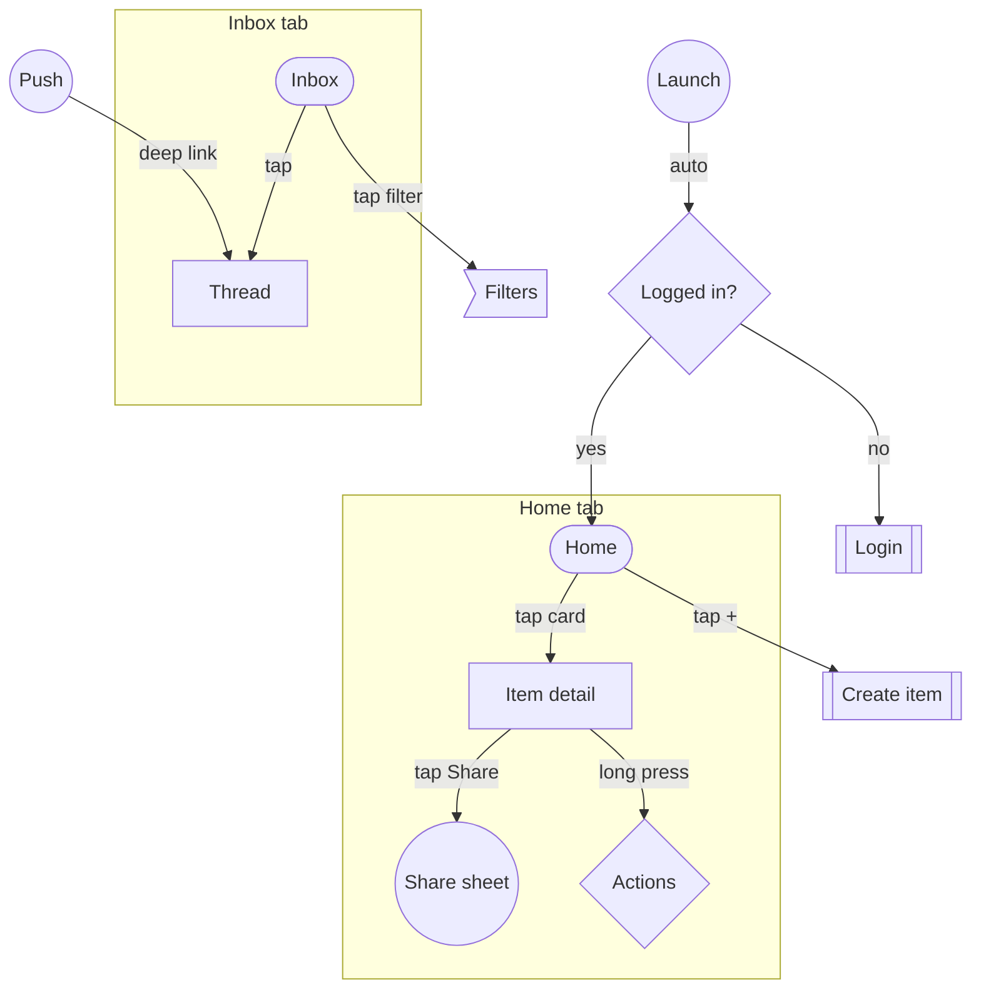

# Navigation graph

Used at step 2. The graph is Mermaid so it lives in the contract and renders on GitHub.

## Node types

| Type | Mermaid shape | Use for |
|------|---------------|---------|
| `tab` | `([ ])` stadium | Top-level destinations of the tab bar |
| `screen` | `[ ]` rectangle | Pushed stack screens |
| `modal` | `[[ ]]` subroutine | Full-screen modal flows (create, edit, onboarding) |
| `sheet` | `>  ]` flag | Bottom sheets |
| `drawer` | `[/ /]` parallelogram | Side drawer (rare, Android-leaning) |
| `dialog` | `{ }` rhombus | Alerts, confirmations, action sheets |
| `external` | `(( ))` circle | System screens, browser, other apps, OS settings |

## Edge labels

`tap`, `swipe`, `long press`, `back`, `pull to refresh`, `deep link`, `push`, `auto` (redirect, e.g. session expired), `share in`.

## Rules

- Every screen is reachable, and every non-tab screen has a way back (back, close, or completion).
- Group each tab's stack in a `subgraph`.
- Show global entry points: cold start, deep links, push notifications, auth redirects.
- Keep depth shallow: a core task should be at most 2 to 3 taps from a tab.
- Mark the first screen after launch.

## Example

## Legend to add under the graph

Shapes: stadium = tab, rectangle = screen, double box = modal, flag = bottom sheet, rhombus = dialog, circle = external or system. Labels on arrows = the interaction.
