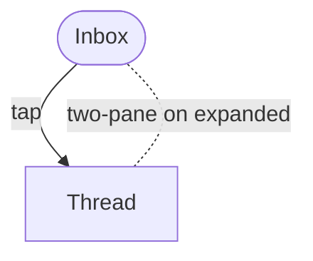

# Tablets and foldables

Used at steps 2 and 4, only when tablets or foldables are in scope in the contract. Without an explicit requirement, design for phones first and only make sure the app does not break on a tablet (no stretched layouts, no locked orientation crash, no cut content). Windowing behavior changes with each iPadOS and Android release: check the official pages (see `sources.md`).

## Size classes and adaptive windows

| | iOS / iPadOS | Android |
|---|---|---|
| Unit of decision | Horizontal size class: compact or regular | Window size class by width: compact (< 600 dp), medium (600–840 dp), expanded (≥ 840 dp), plus larger classes on recent versions |
| What it depends on | The window, not the device: an iPad in a narrow split is compact | The window, not the device: a tablet in split screen can be compact |
| Rule | Layout follows the current size class and updates when it changes | Same; never branch on "is tablet" |
| Resizability | iPad apps must support resizable windows and multitasking unless explicitly opted out (and opting out is being phased out) | Recent Android versions ignore orientation and resizability restrictions on large screens for apps targeting them (verify for the target API level) |

## Navigation by width

| Width | iOS / iPadOS | Android |
|-------|--------------|---------|
| Compact | Tab bar | Navigation bar |
| Medium | Tab bar, or sidebar-adaptable tab bar | Navigation rail |
| Expanded | Sidebar (tab bar can turn into a sidebar on iPad) | Navigation rail, or permanent navigation drawer for many destinations |

Same destinations at every width: only the container changes.

## List-detail

| Rule | Detail |
|------|--------|
| Two panes | On regular / expanded width, list on the left, detail on the right (`NavigationSplitView` / `UISplitViewController`, Compose list-detail scaffold) |
| Selection | One item selected and highlighted; detail pane never empty (first item or an empty-state message) |
| Collapse | On compact width the same screens become a stack push; the selected item stays open on resize |
| Three panes | Sidebar + list + detail only on the widest windows |
| Content width | Readable line length for text; forms and detail content capped in width, centered |

## Multitasking and rotation

| Rule | Detail |
|------|--------|
| Split view / split screen | Every layout works from a narrow third to full screen |
| Multiple windows | Support several windows only if a real use case exists (compare two documents); each window keeps its own state |
| Rotation | Supported on tablets; state and scroll position survive (Android configuration change, process recreation) |
| Drag and drop | Between apps for images, text and files when the content lends itself to it |

## Keyboard and pointer

| Rule | iPadOS | Android (tablets, ChromeOS) |
|------|--------|-----------------------------|
| Shortcuts | Key commands for frequent actions, listed in the menu shown by holding ⌘ (or the menu bar on recent iPadOS) | Keyboard shortcuts, listed in the shortcuts helper |
| Focus | Tab moves focus; Return activates | Arrow keys and Tab move focus, visible focus indicator |
| Pointer | Hover effects on interactive elements; right click opens the context menu | Hover states; right click opens the context menu |
| Text fields | Return submits, Esc cancels a sheet | Same |

## Foldables

| Topic | Rule |
|-------|------|
| Continuity | Folding or unfolding keeps the screen, scroll position and input; the layout switches size class |
| Postures | Tabletop (half-folded, horizontal hinge): content top, controls bottom; book (vertical hinge): two panes split at the hinge |
| Hinge | Never place a button or text across a separating or occluding hinge (Jetpack WindowManager `FoldingFeature`) |
| Cover screen | Treat as a compact phone window |

## In the graph and the contract

| Where | What to write |
|-------|---------------|
| Contract, framing | Form factors in scope: phone, tablet, foldable; orientations |
| Graph | One graph for all sizes; mark list-detail pairs that become two panes with a dotted link labelled `two-pane on expanded` (notation in [navigation-graph.md](navigation-graph.md)) |
| Contract, conventions | One row per adaptive screen: compact vs regular / expanded layout, navigation container per width |
| Contract, states | Empty detail pane state for each list-detail pair |

